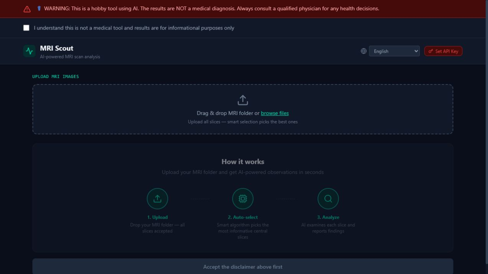
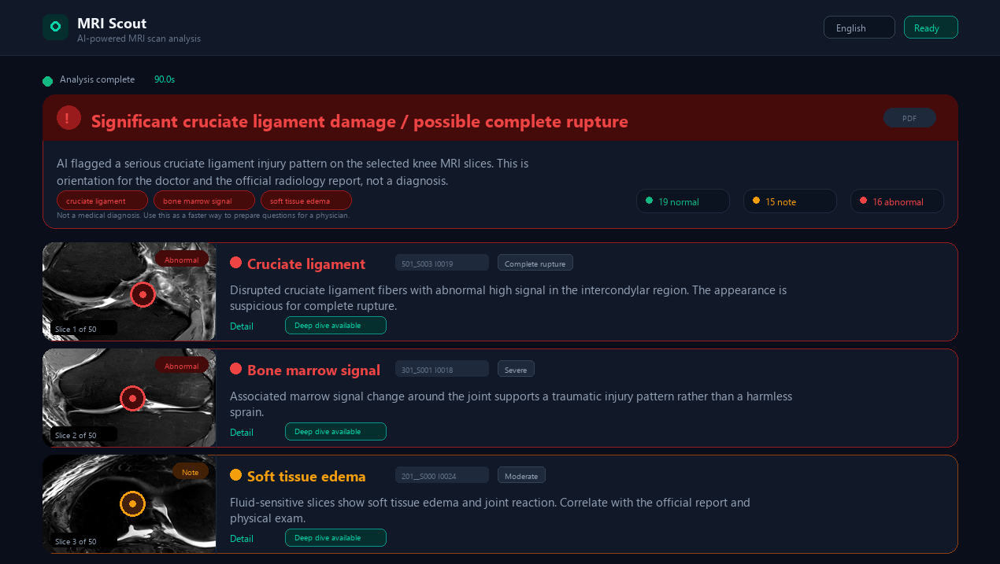

# MRI Scout

AI-powered MRI image review for people who have their scan files but still have to wait for the official report.

MRI Scout runs locally in your browser. You upload exported MRI images, the app selects representative slices, sends them to an AI vision model, and shows a structured orientation report with per-slice findings and markers.

> WARNING: MRI Scout is a hobby and educational tool. It is not a medical device and it is not a diagnosis. Always use the official radiology report and a qualified physician for medical decisions.

## Screenshots

### Upload and slice selection



### Results with scan markers



## What It Does

- Upload MRI image exports such as JPG, PNG, or WEBP.
- Group scans by MRI series from filenames.
- Select representative central slices instead of sending every image.
- Analyze the selected slices with an AI vision model.
- Return structured JSON with summary, recommendation, affected structures, severity, and per-image findings.
- Show finding cards with the scan thumbnail, status badge, severity, detail text, and marker position.
- Run a deeper follow-up pass when the first analysis asks for neighboring slices.
- Export a print-ready report from the result screen.
- Support multiple output languages.

MRI Scout is useful for the gap between the scan and the official result. It can help you ask better questions sooner. It should not decide treatment.

## Real Test

The app was tested on a real exported knee MRI set:

- 232 JPG files
- 6 MRI series
- 50 representative slices selected by the app
- 26.5 MB payload sent to the AI model
- structured result returned in about 90 seconds

In that test, the app flagged a serious cruciate ligament injury pattern, including possible complete rupture, plus related bone marrow signal and soft tissue edema. That is exactly the kind of result where the app should tell you to get proper medical review, not pretend to be a doctor.

Three days later, the official result came back. MRI Scout was very close to what the report said. Not perfect, and not something to use instead of a doctor, but close enough to prove the point: waiting completely blind does not make much sense when the scan data already exists.

## How It Works

1. Upload an MRI folder or selected image files.
2. MRI Scout groups the files into series and finds the useful central region.
3. The app sends a capped set of slices to the selected AI provider.
4. The model returns structured findings.
5. MRI Scout renders the recommendation, counts, affected structures, and per-slice finding cards.
6. If needed, a deeper pass can inspect neighboring slices around suspicious areas.
7. You can export the result as a report.

## AI Providers

MRI Scout supports:

- OpenAI via `OPENAI_API_KEY`
- Google Gemini via `GOOGLE_GENERATIVE_AI_API_KEY`

You can configure the key in `.env.local`, or use the in-app key setup. The key is stored locally. Scan images are sent to the selected AI provider for analysis.

Example `.env.local`:

```env
OPENAI_API_KEY=your_openai_key_here
```

or:

```env
GOOGLE_GENERATIVE_AI_API_KEY=your_google_key_here
```

## Important Limits

- MRI Scout does not read CDs directly.
- MRI Scout is not a DICOM viewer.
- If your scan is on a CD, copy the data first.
- If your files are DICOM, export them to JPG, PNG, or WEBP before upload.
- The app does not replace radiology, orthopedics, or emergency care.

## Status

MRI Scout is free under the MIT license.

I do not plan to maintain it as a real product, and honestly I hope I will not need it again. But if someone else needs a similar tool, they do not have to start from zero. Most likely, upgrading the model and maybe refreshing the UI will be enough to keep it useful for a while.

## Tech Stack

- Next.js App Router
- TypeScript
- Tailwind CSS
- OpenAI SDK
- Google Generative AI SDK
- Lucide React icons

## Getting Started

### Prerequisites

- Node.js 20+
- An OpenAI API key or Google AI API key

### Installation

```bash
git clone https://github.com/lukashanes/AI-MRI-scout.git
cd AI-MRI-scout
npm install
```

### Configuration

Create `.env.local` in the project root:

```env
OPENAI_API_KEY=your_openai_key_here
```

or:

```env
GOOGLE_GENERATIVE_AI_API_KEY=your_google_key_here
```

### Run

```bash
npm run dev
```

Open `http://localhost:3000`.

### Build

```bash
npm run build
```

## Project Structure

```text
app/
  page.tsx                    Main application
  report/page.tsx             Print-ready report page
  api/analyze/route.ts        Streaming analysis endpoint
components/
  upload-zone.tsx             Drag and drop upload
  series-filmstrip.tsx        Series and slice selection preview
  finding-card.tsx            Per-slice finding card with marker
  image-lightbox.tsx          Fullscreen scan preview
  api-key-setup.tsx           Local API key setup
lib/
  image-selector.ts           Series grouping and representative slice selection
  i18n.ts                     UI and prompt language support
  providers/
    index.ts                  Provider registry
    openai.ts                 OpenAI vision provider
    gemini.ts                 Gemini vision provider
    system-prompt.ts          MRI analysis prompt
```

## Privacy

MRI Scout does not add custom server-side scan storage. In local development, the selected images live in the browser session and are sent to the selected AI provider when you run analysis. Review your provider's data policy before using real medical data.

## License

[MIT](LICENSE)

## Author

Lukas Hanes

- Web: [lukashanes.com](https://lukashanes.com/)
- X/Twitter: [@lukhanes](https://x.com/lukhanes)
- GitHub: [@lukashanes](https://github.com/lukashanes)
